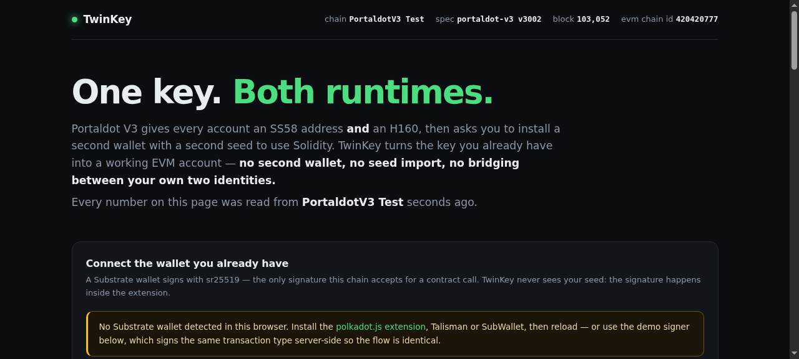
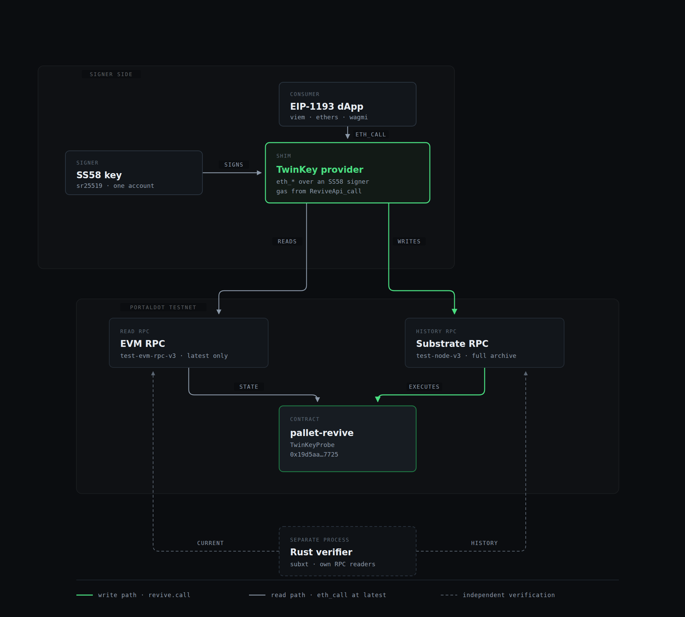

# TwinKey

**One key, both runtimes.** TwinKey makes a Portaldot SS58 wallet sign for Solidity dApps on
Portaldot V3 — the same key that holds your POT pays gas, calls contracts, and reads state over a
standard EVM interface. No second wallet, no seed import, no bridging between two identities.

> Status: **in build** (Portaldot Hacker House 2026, track *Modular Cloud & Middleware*).
> Live chain facts, including the ones this product depends on, are in
> [`docs/VERIFIED-FACTS.md`](docs/VERIFIED-FACTS.md) — every one reproducible with a `curl`.



The screenshot above is the deployed app: both faces of one account resolved from the chain, live
contract state over `eth_call`, a real write, decoded `revive.ContractEmitted` events, and the Rust
verifier's verdict for block 90995.

**Live demo:** <https://twinkey.vercel.app>
**Verifier:** <https://twinkey-verifier.onrender.com/ready> (Rust, Render — free tier, so the first
request after an idle spell takes ~30–60 s to cold start). `/ready` is the deep check (both upstream
RPCs, head block); `/health` is liveness only and answers from memory, because Render kills the
instance when its own probe takes more than 5 s

The deployed instance runs the write path with a **dedicated throwaway demo account**
(`5He7dvDWyMs7DAiAVBsfczFZPEKVa5tAQwLQjNTSq3beUAHZ` → `0xfd2d914e…62e7`), funded with 5 tPOT and
rate limited to 3 writes per minute per IP, so the write button works for a judge without an
extension. It is deliberately *not* the project key. Connect your own wallet to sign as yourself.

---

## The problem

Portaldot Network V3 gives every account **two faces**: a native `AccountId32` (SS58, prefix 42,
the one every Portaldot/polkadot.js wallet produces) and an `H160` address on the EVM side. The two
are linked by the runtime — `ReviveApi.address(account_id32)` returns the H160 — but nothing in the
ecosystem exposes that link to users or to dApps.

The consequence, today, on the live testnet:

- A Portaldot user opens any Solidity dApp and is told to install a different wallet with a
  different seed phrase. Their POT cannot sign an EVM transaction.
- A dApp built with `viem` / `wagmi` / `ethers` cannot talk to a Portaldot wallet at all: those
  libraries expect an EOA that signs `eth_transact`-style transactions, while the account that
  actually holds the funds is an sr25519 Substrate account.
- The runtime *does* allow a native account to drive contracts (`revive.call`,
  `revive.instantiate_with_code`), and the Portaldot team's own guide documents it as a manual
  four-step procedure in the node console: generate calldata, dry-run through `reviveApi.call` to
  obtain `weight_limit` and `storage_deposit_limit`, then submit `Revive.call` from the
  Extrinsics tab. Nothing in the ecosystem implements that flow — no wallet, no SDK, no dApp.
- In the other direction, the EVM write path that MetaMask/Remix users are told to use **does not
  accept transactions from an external EOA on the current testnet build** (every type, fee and gas
  combination returns `Invalid Transaction`; `revive.originalAccount` is unset for the EOA while its
  balance is displayed). Reads, `eth_call` and `eth_estimateGas` work normally. Full reproduction:
  [`docs/FINDINGS.md`](docs/FINDINGS.md).


So the chain's headline feature — EVM compatibility — is unusable by the people the chain already
has. TwinKey closes that gap.

## What TwinKey is



One key, two endpoints: reads go to the EVM RPC at `latest`, writes go to the Substrate RPC as
`revive.call` extrinsics signed by the SS58 key, and a separate Rust process checks that both sides
agree. The editable source of that diagram is
[`docs/diagrams/architecture.html`](docs/diagrams/architecture.html) — open it in a browser, no build
step.

1. **A signer bridge.** Connect the Substrate wallet you already have (Portaldot extension,
   polkadot.js extension, or any injected SS58 signer). TwinKey resolves your `H160` through the
   chain's own runtime API, shows both identities as one account, and submits contract calls as
   native `revive.call` extrinsics signed by your sr25519 key.
2. **An EIP-1193-shaped provider.** The same capability as a drop-in provider
   (`window.ethereum`-shaped) so existing EVM tooling — `viem`, `wagmi`, plain `ethers` snippets —
   works against a Substrate signer with no rewrite. The dApp developer changes one line.
3. **A parity receipt.** For every call, TwinKey can execute the same input through both paths
   (native `revive.call` and EVM `eth_transact` / `eth_call`) and have an independent verifier
   assert that post-state, events, and value accounting agree — including across the 14-decimal
   native / 18-decimal EVM denomination split. This is the proof that the dual runtime is one
   runtime, and it is what turns a *wallet adapter* into *infrastructure*.

## Who it is for

- **Portaldot users with an SS58 wallet** who want to use Solidity dApps without a second identity.
- **dApp developers on Portaldot V3** who want the wallet base that already exists, instead of
  asking new users to install MetaMask and buy gas twice.
- **The next chain running `pallet-revive`** — the same adapter is not Portaldot-specific: it works
  against any `pallet-revive` runtime that exposes the same runtime API.

## Why now

Portaldot V3 (runtime `portaldot-v3` v3002) is the first Portaldot runtime with `pallet-revive`
alongside `pallet-contracts`, and the EVM endpoint has been public since October 2026. The chain
has issuance, validators and a live testnet, and — at the time of writing — **no deployed
contracts and no wallet path from the native side**. The adapter has to exist before the first
dApp can onboard its first user.

## Core user experience

1. Land on the app. Connect the Substrate wallet you already have.
2. Your account appears once, with both faces: `5DM…Bko9C7` and `0xe70f…d934`, with the derivation
   fetched live from the chain (not guessed, not truncated).
3. Pick a contract, call a function, sign once in your existing wallet. TwinKey encodes the call,
   submits it, tracks the receipt, decodes the events.
4. Flip to the parity pane: the same call through the EVM path, with the verifier's verdict.

## Architecture

```
[Substrate signer]  ──sign revive.call──▶  [TwinKey app]  ──▶ [Substrate RPC] ──▶ pallet-revive
        │                                        │                                     │
        │  ReviveApi.address  ◀── H160 ──        │  viem/EIP-1193 shim                 │ state+events
        ▼                                        ▼                                     ▼
   one account                            [Rust verifier]  ◀── eth-rpc / Substrate RPC ──
                                          /verify/:tx, /parity/:tx
```

- Web app: Next.js (App Router) + TypeScript + Tailwind, deployed on Vercel.
- Signer + chain access: `@polkadot/api`, `@polkadot/extension-dapp`, `viem` for encoding.
- Verifier: Rust (Axum + tokio + subxt) — reads the chain independently of the browser and returns
  a verdict a judge can `curl`.

## Repository layout

```
app/        Next.js front end + the EIP-1193 provider shim
agent/      Rust verifier service (/verify/:tx, /parity/:tx)
tooling/    Node scripts used during development (inspect revive extrinsics, deploy, parity runs)
contracts/  Solidity contracts used for the demo and the parity harness
docs/       VERIFIED-FACTS.md (chain facts with the commands that produced them), notes
```

## Running it

```bash
# 1. the app (Next.js) — provider shim + console + decoded EVM event feed
cd app
npm install
npm run dev                       # http://localhost:3000
# optional: enable the in-app demo write with a testnet key file
#   PORTALDOT_KEY=~/.hermes/keys/portaldot-testnet.json npm run dev

# 2. the end-to-end proof: drives the provider like viem would and prints a verdict
npx tsx scripts/e2e-provider.ts 2077

# 3. the Rust verifier (independent of the browser)
cd ../agent
cargo run --release               # http://localhost:8088/verify/block/90990
```

Exact commands and their output are in [`docs/BUILD-LOG.md`](docs/BUILD-LOG.md).

## Verification — what is real, what is not

| Claim | State |
|---|---|
| Portaldot V3 testnet reachable, chain id, decimals, address mapping | **real, verified by `curl`** — `docs/VERIFIED-FACTS.md` |
| A registered testnet wallet is funded | **real** — mapped `H160` holds ~401.7 tPOT as of 2026-10-19 |
| Native `AccountId32` → `H160` mapping via runtime API | **real** — `ReviveApi_address` returns `0xe70f…d934` for `5DM…Bko9C7` |
| Contract deployed on the testnet by an ss58 key | **real** — `0x19d5aa109cbf0d4e0a126f1438ea73b619cb7725`, deploy block 90990 |
| Contract called by the same ss58 key, state read back over EVM RPC | **real** — call block 90995; later calls at 102680, 102716, 102852 |
| **An EIP-1193 `eth_sendTransaction` executes on chain via an ss58 signature** | **real** — `app/scripts/e2e-provider.ts` 12/12, tx `0x6aac8a66…34f8` |
| **`eth_getTransactionReceipt` returns a receipt with a decoded EVM log** | **real** — `ValueSet(caller=0xe70f…d934, value=2077, callCount=4)` |
| **`eth_estimateGas` returns the real cost, not the EVM endpoint's inflated value** | **real** — 50,604,168 vs 417,905,553,159 (8,258×) |
| Dry-run → exact `weight_limit` / `storage_deposit` → execute | **real** — `weightRequired {506041677, 31937}` on an earlier call |
| External EOA can write over the EVM JSON-RPC | **no** — `Invalid Transaction` for every tx type; see `docs/FINDINGS.md`. Reads work. |
| `eth_getLogs` returns logs from native-path calls | **no** — returns `[]` for our own contract across the full range. The app scans Substrate events and merges receipts instead. |
| Rust verifier verdict for a call | see `agent/` — endpoints and their real output are in the agent README |


No mocked behaviour is presented as real here. Anything simulated is labelled as such in the app
itself and in the README at submission time.

## Security notes

- TwinKey never holds keys and never asks for a seed. All signatures happen inside the user's own
  wallet extension.
- Native `revive.call` transfers are signed as Substrate extrinsics, so the trust model is
  Substrate's, not an EVM relayer's: there is no custodial relayer in the loop.
- The app validates the address mapping against the chain on every connect; it never derives the
  H160 locally (a local derivation that disagrees with the chain is the failure mode that loses
  funds).
- Amounts are handled as bigint with an explicit decimal context per side (14 native / 18 EVM) —
  the single most common way to misreport value on this chain is to assume 18 decimals everywhere.

## Limitations / roadmap

- Native path requires a Substrate signer; a wallet that only exposes secp256k1 EVM keys cannot use
  `revive.call` (it uses the EVM path instead — supported, but a different flow).
- `pallet-revive` semantics differ from the EVM in places (PolkaVM); the parity harness exists to
  make those differences explicit instead of surprising.
- Roadmap: multi-contract batching, ERC-20 precompile support, and a packaged provider
  (`npm i twinkey`) that any Portaldot dApp can drop in.

## References

- **PortaldotV3 Testnet Guide** (official, English translation) —
  <https://github.com/ItsCogumellum/portaldot-v3-testnet-guide>. Its §3.3.2/§3.4.4 document the
  manual native-call flow this project automates; its §3.4.2 documents the H160 ↔ SS58 funding trick;
  `demo/04_solidity_demo.py` is the reference implementation of the dry-run in Python. TwinKey's
  `tooling/call-dryrun.mjs` is the same flow in TypeScript.
- Polkadot SDK `pallet_revive` — `AddressMapper`, `ContractResult`, storage-deposit semantics.

## License

MIT. Portaldot Hacker House 2026 submission.
